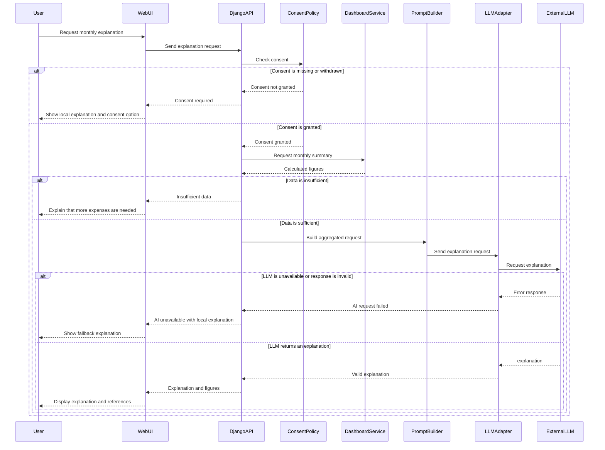

Figure: Sequence diagram for generating an AI spending explanation. Django
first verifies the user's consent, then calculates financial figures locally
before sending only minimum aggregated data through the LLM adapter. The LLM
returns advisory text only. Missing consent, insufficient records, provider
failure, or invalid AI output never prevents the user from using expenses,
budgets, or dashboard features.
