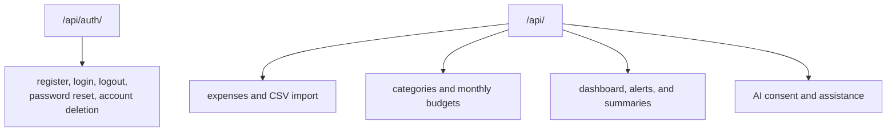

# Release 1 API design

All endpoints use the `/api/` prefix. Browser clients use Django session
authentication; every state-changing request also requires a valid CSRF token.
The server derives the owner from the authenticated session and never accepts a
user ID from the client.



## Account access

| Endpoint | Method | Purpose |
| --- | --- | --- |
| `/auth/register/` | `POST` | Create an account with email and password. |
| `/auth/login/` | `POST` | Create an authenticated browser session. |
| `/auth/logout/` | `POST` | End the current authenticated session. |
| `/auth/password-reset/` | `POST` | Request a password-reset email. |
| `/auth/password-reset-confirm/{uid}/{token}/` | `POST` | Set a password using a valid single-use reset link. |
| `/auth/account/` | `DELETE` | Request and confirm account deletion under the retention policy. |

## Finance resources

| Endpoint | Methods | Purpose |
| --- | --- | --- |
| `/categories/` | `GET` | Return the predefined Release 1 expense categories. |
| `/expenses/` | `GET`, `POST` | List owned expenses or create an expense. Filters: `month`, `category_id`. |
| `/expenses/{id}/` | `GET`, `PATCH`, `DELETE` | Retrieve, change, or delete one owned expense. |
| `/expenses/import/preview/` | `POST` | Parse and validate a CSV without saving rows. |
| `/expenses/import/confirm/` | `POST` | Save the user-confirmed valid CSV rows. |
| `/budgets/` | `GET`, `POST` | List or create a monthly category budget. |
| `/budgets/{id}/` | `GET`, `PATCH`, `DELETE` | Retrieve, change, or delete one owned budget. |
| `/dashboard/` | `GET` | Return monthly totals, category totals, remaining budgets, and alerts. |
| `/summaries/{year}/{month}/` | `GET` | Return the monthly summary and prior-month comparison when available. |

## AI consent and assistance

| Endpoint | Method | Purpose |
| --- | --- | --- |
| `/ai/consent/` | `GET`, `PUT` | Read or grant/withdraw external AI-processing consent. |
| `/ai/explanations/monthly/` | `POST` | Return a data-grounded explanation using backend-calculated aggregates. |
| `/ai/suggestions/` | `POST` | Return up to three data-grounded suggestions, or an insufficient-data result. |

The AI endpoints must return a consent-required response when consent is absent
or withdrawn. They must never accept direct financial values as authoritative
input, create records, update records, delete records, or give investment
advice.

## Core request and response shapes

### Create an expense

```json
POST /api/expenses/
{
  "amount": "45.50",
  "occurred_on": "2026-11-20",
  "category_id": 1,
  "description": "Lunch"
}
```

```json
201 Created
{
  "id": 42,
  "amount": "45.50",
  "occurred_on": "2026-11-20",
  "category": { "id": 1, "name": "Food & Dining" },
  "description": "Lunch"
}
```

### Create a monthly budget

```json
POST /api/budgets/
{
  "category_id": 1,
  "budget_month": "2026-11-01",
  "amount": "500.00"
}
```

The backend returns `400 Bad Request` for invalid fields or a duplicate
user/category/month budget, `401 Unauthorized` for a missing or expired
session, `403 Forbidden` for cross-user access, and `404 Not Found` when an
owned resource does not exist.
