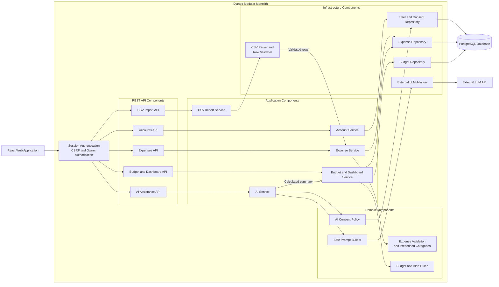

Figure: Component diagram of the Django modular monolith. Each API component
delegates to a focused application service. Domain components enforce expense,
budget, alert, and consent rules. Repositories provide the only path to
PostgreSQL. The AI Service receives backend-calculated summaries,
checks consent, and uses an adapter to call the external LLM; it does not access
financial repositories directly.
