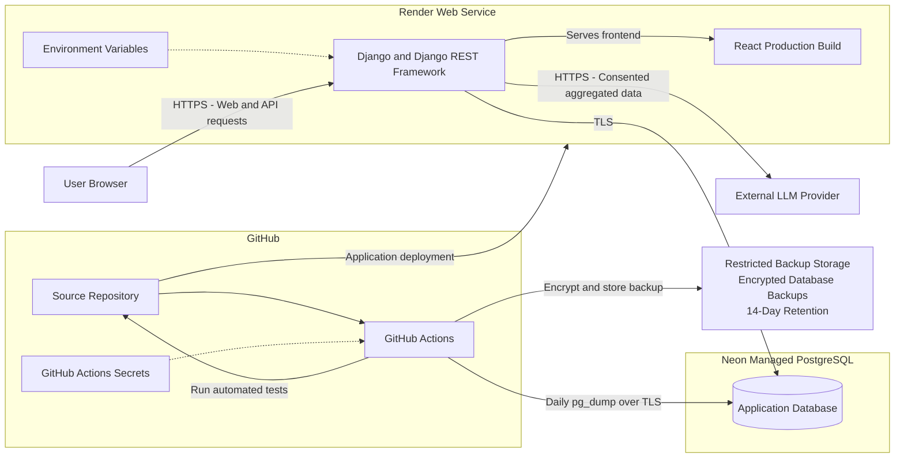

Figure: Proposed Release 1 deployment diagram. The React production build and
Django application run together in one Render web service, so browser sessions
remain same-origin. Neon hosts PostgreSQL outside the application filesystem.
The Django AI integration sends only consented, backend-calculated aggregates
to the external LLM. GitHub Actions runs tests and produces encrypted daily
database backups with restricted storage and a 14-day retention target.
