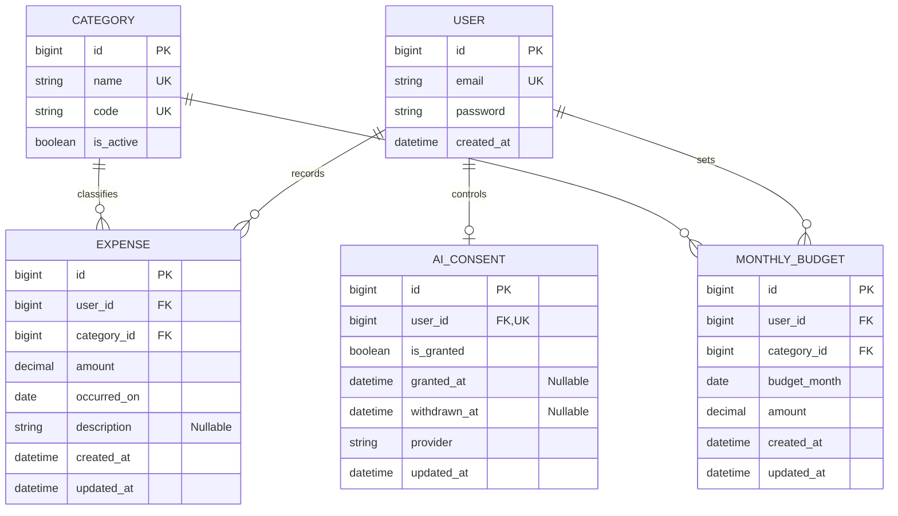

## Normalization and constraints

The database schema follows Third Normal Form (3NF). Each table represents a distinct concept, and non-key attributes depend on the table's key. Category names are stored centrally rather than duplicated across expense and budget records.

- `CATEGORY` is a predefined system catalogue for Release 1; users do not
  create custom categories.
- `EXPENSE.amount` and `MONTHLY_BUDGET.amount` use fixed-precision decimals
  and must be greater than zero.
- `MONTHLY_BUDGET` requires a unique constraint on
  `(user_id, category_id, budget_month)` to enforce one monthly category budget
  per user.
- `AI_CONSENT.user_id` is unique, so it stores one current consent state per
  user. The backend must block external AI calls when `is_granted` is false.
- Recommended indexes are `(user_id, occurred_on)` for expense filtering and
  `(user_id, category_id, occurred_on)` for dashboards and budget alerts.
