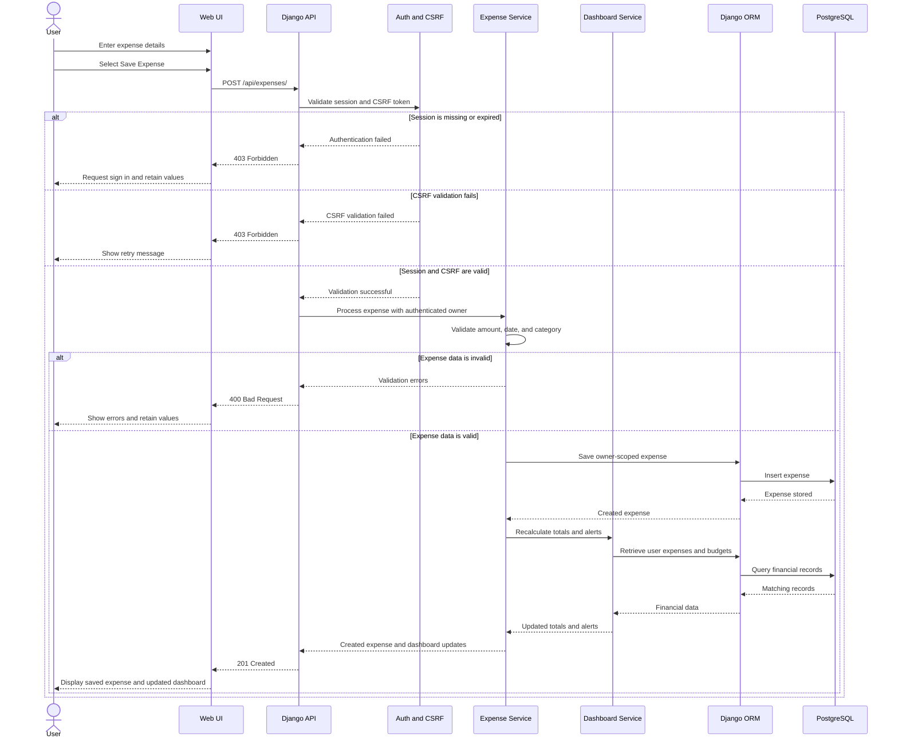

Figure: Sequence diagram for recording an expense. The browser submits an
authenticated, CSRF-protected request. Django validates the session and
expense fields before storing an owner-scoped expense. After a successful save,
the system recalculates dashboard totals, budget status, and alerts. Invalid or
unauthenticated requests do not create an expense and preserve entered values
for retry.
