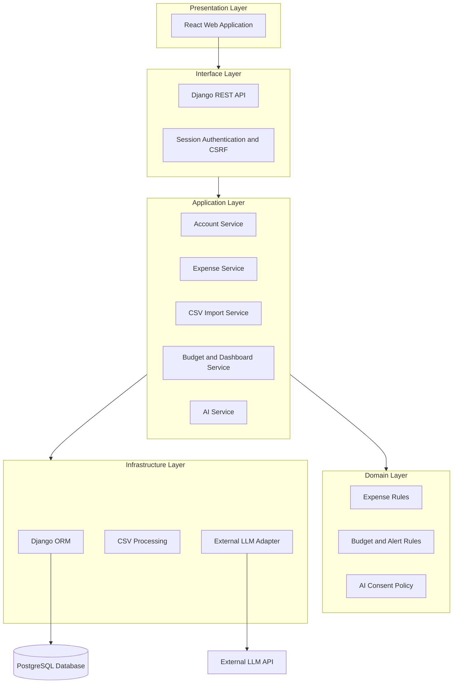

Figure: Layered architecture of the AI Personal Finance Analysis and Assistance System. The system follows a layered client-server architecture implemented as a Django modular monolith. The React web application sends HTTPS requests to the Django REST API, where session authentication, CSRF protection, and owner authorization are applied before requests reach application services. The Accounts, Expenses, Budget and Dashboard, and AI services implement the main business functions. Domain rules validate expenses, enforce predefined categories, calculate budgets and alerts, and control AI-data-sharing consent. Infrastructure components provide CSV validation, database access through Django ORM repositories, PostgreSQL storage, and controlled communication with the external LLM API. The AI service receives only consented, backend-calculated aggregate data and produces explanations; it cannot create, update, or delete financial records.
